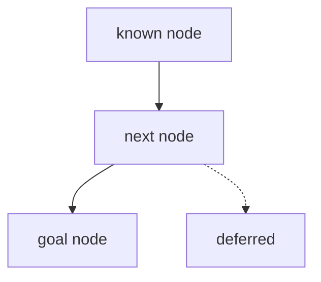

# Note Template (fallback)

Use this when the vault has no fitting template under `templates/`. Keep the shape, drop the sections that do not apply, and write in the learner's language.

The note is a **re-derivation aid**, not a transcript. Dense and structured, not conversational. One note per topic.

````markdown
---
title: <topic>
goal: <the agreed capability, one line>
created: <date>
status: in-progress | done
tags: [learning]
---

# <topic>

## Goal and boundary

- **Can do at the end:** <capability, measurable>
- **Entry node (already known):** <what the session builds on>
- **Out of scope:** <deliberately skipped, so future-you does not wonder>

## Map



Nodes are knowledge; edges are the logical relation ("B follows from A because ..."). Version the map as the session grows — it is the thing the learner should be able to reproduce from memory.

## Units

### 1. <unit title>

- **Hangs from:** <earlier node>
- **Unlocks:** <what this enables>
- **Core point:** <one or two sentences, ideally the derivation, not the definition>
- **Worked example:** <the concrete instance that carried the step>

### 2. <unit title>

…

## Checks

### 1 — <edge tested>

- **Q:** <question>
- **Answer:** <what the learner picked, and the reason given>
- **Diagnosis:** <the specific missing or wrong edge>
- **Status:** passed | repaired, then passed a variant | still open

## Summary path

The reconstruction, in order — each line is a step a future reader can walk:

1. <node> — because <edge from the previous node>
2. …

## Open edges

- <the next node this unlocks, if the learner continues>
- <where understanding is still thin>
````

## Rules that keep this useful

- **Top-down mermaid only** (`flowchart TD`). Left-right layouts break in narrow panes.
- **Generated images go in `attachments/`**, embedded by relative path, only when a diagram cannot express the content.
- **No enclosed numerals** (① ② ③). Use `1.` `2.` `-`.
- **Write incrementally.** Append each unit when it is verified — a note written at the end loses the diagnosis trail, which is its most valuable part.
- **Keep the "Open edges" section alive.** It is the handoff to the next session, and the honest part of the map.
