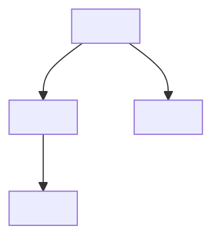

# Learning Note Template

Skeleton for the synced note in a `learning-tutor` session. Copy it into the current directory at step 0, keep the headings, and fill each section as the corresponding step completes.

Keep the note in a form Obsidian renders cleanly: one H1 title, H2 per session phase, Mermaid diagrams in fenced blocks.

```markdown
# <Topic> — Learning Session

- Date: <YYYY-MM-DD>
- Goal: <one sentence, worded as the learner confirmed it>
- Status: <framework / goal set / boundary verified / plan agreed / in progress / done>

## Knowledge framework

Core concepts:

| Concept | Definition | Prerequisites |
| --- | --- | --- |
| <name> | <one line> | <concept or "none"> |

Relations:



- Entry points: <where a beginner can start>
- Depth available: <what mastery looks like>

## Goal

<The agreed goal. Note the alternatives that were rejected, so the scope stays stable.>

## Cognitive boundary

Evidence from the working directory:

- <file, language, or tool> -> <what it implies about existing knowledge>

| Concept | Evidence | Quiz result | Verdict |
| --- | --- | --- | --- |
| <name> | <why it was suspected known/unknown> | <correct/incorrect and note> | known / partial / unknown |

Starting point: <concepts the teaching builds from>

Skip list: <what will not be explained again>

## Learning plan

| Stage | Task | Deliverable | Mastery check |
| --- | --- | --- | --- |
| 1 | <task> | <what exists when done> | <question used to verify> |
| 2 | <task> | <what exists when done> | <question used to verify> |

## Progress log

### Stage 1 — <title>

- Taught: <key points>
- Mastery check: <question asked, learner answer, verdict>
- Fix applied: <misunderstanding corrected, or "none">

### Stage 2 — <title>

- Taught:
- Mastery check:
- Fix applied:

## Revisions

Record every time the session went backwards, so the final review can explain why.

- <date, step reverted from/to, reason>

## Summary

- Starting point: <where the session began>
- Key nodes now held: <list>
- Connections formed:

```mermaid
graph TD
  <post-session map, richer than the initial framework>
```

- Still open: <remaining gaps, in priority order>
- Next session starts from: <updated boundary>
```

## Conventions

- The Mermaid map should grow across the session; the final version in "Summary" is the artifact worth keeping.
- Attach any SVG or PNG under `attachments/` and reference it with `![[attachments/<file>]]`.
- One row per quiz question in the boundary table and one entry per check in the progress log — the log is what makes a later session's boundary estimate credible.
